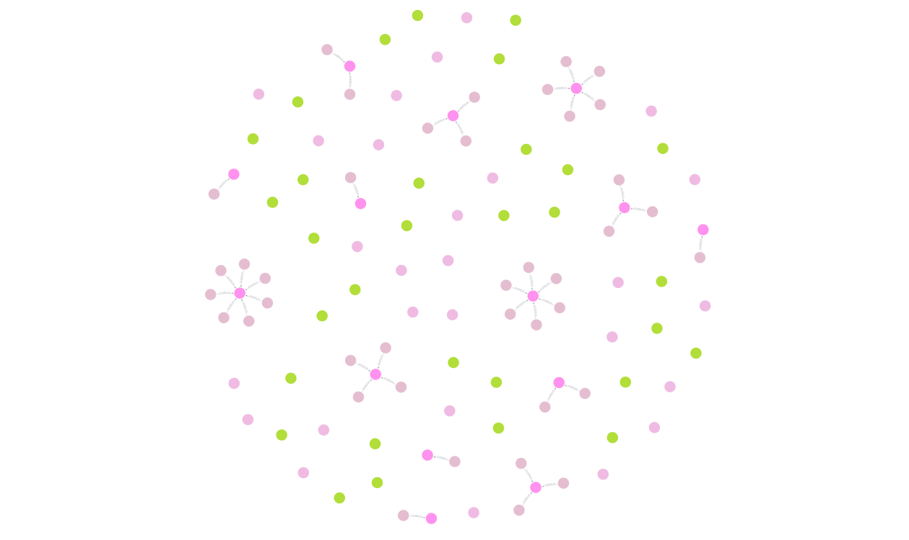
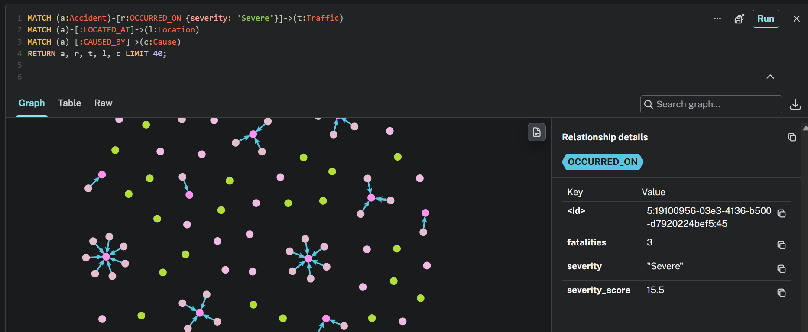
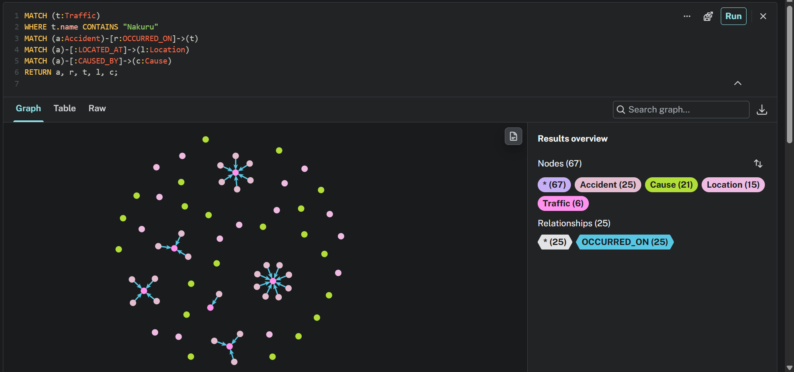

# ICS 2315: Data Architecture & Warehousing
## Final Deliverable: Comprehensive Coursework Summary Report

**Author:** Kelvin Abidha  
**Course:** ICS 2315 — Data Architecture & Warehousing  
**Reference Textbook:** *Database System Concepts (7th Edition)*, Silberschatz, Korth, Sudarshan (Chapter 10: Big Data)  
**Repository:** [GitHub: KelvinAbidha/Data-Warehousing-Project](https://github.com/KelvinAbidha/Data-Warehousing-Project.git)

---

## 1. Executive Summary & Theoretical Framework

This report documents the implementation and comparative analysis of three modern non-relational database architectures across two distinct enterprise datasets:

1. **Document Store (MongoDB)**: Evaluated for document modeling, B-Tree indexing, execution explain plans, and MapReduce-style aggregation pipelines.
2. **Wide-Column Store (Apache Cassandra)**: Evaluated for query-driven data modeling (Chebotko methodology), consistent hashing partition tokens, and linear read/write scalability.
3. **Graph Database (Neo4j)**: Evaluated for index-free adjacency, entity-relationship topology, and multi-hop Cypher traversals.

### Theoretical Alignment with Chapter 10 (*Big Data*)

| Theoretical Concept | Textbook Focus | Practical Application in Project |
| :--- | :--- | :--- |
| **Partitioning & Sharding** | Section 10.1 (p. 467–473) | Cassandra's `Murmur3Partitioner` hashes partition keys to map rows across cluster token rings. |
| **Query Optimization** | Section 10.2 & Chapters 12–13 | MongoDB `.explain("executionStats")` diagnosing `COLLSCAN` vs `IXSCAN` and index memory sorting. |
| **MapReduce Paradigm** | Section 10.3 (p. 483–490) | Multi-stage aggregation pipelines (`$match`, `$group`, `$sort`) processing 81,504 market records. |
| **Index-Free Adjacency** | Chapter 10 Storage | Neo4j direct-pointer traversal ($O(1)$ per edge hop) eliminating relational multi-table `JOIN` bottlenecks. |

---

## 2. Assignment 1: NoSQL Data Processing (NSE Stock Market)

### 2.1 ETL & Data Pipeline (`src/etl.py`)
The Nairobi Securities Exchange (NSE) dataset spans six years (2007–2012) across six CSV files containing 81,504 raw trading rows. 

```
Raw CSVs (2007-2012) ──► Header Normalization ──► Data Cleaning ──► Cleaned Dataset (81,504 rows)
(Inconsistent casing)     (DATE/Date, Adjust)     (Commas, %, '-')   (ISO Dates, Typed Floats/Ints)
```

**Key Data Cleaning Operations:**
- **Header Normalization**: Resolved an integration anomaly where 2008 used Title Case (`Date`, `Adjusted`) while 2007/2009–2012 used uppercase (`DATE`, `Adjust`).
- **Type Coercion**: Stripped commas from trading volume (`"7,800"` $\rightarrow$ `7800` `int64`) and percentage symbols from daily change (`"1.50%"` $\rightarrow$ `1.50` `float64`).
- **Null Handling**: Converted non-standard dash markers (`"-"`) into IEEE `NaN` / database `null`.
- **Chronological Sorting**: Converted `M/D/YYYY` strings into ISO `datetime64[us]`.

---

### 2.2 MongoDB Implementation & Query Optimization (`src/mongo_manager.py`)

#### A. Document Schema Design
Rather than normalizing into separate tables, daily trading profiles are stored as nested BSON documents for optimal **locality of reference** (single disk block fetch):

```json
{
  "_id": ObjectId("..."),
  "code": "EQTY",
  "name": "Equity Bank",
  "date": ISODate("2007-01-02T00:00:00Z"),
  "source_year": 2007,
  "trading": {
    "day_price": 141.0,
    "previous_price": 138.0,
    "change": 3.0,
    "change_pct": 2.13,
    "volume": 7500,
    "adjust": 4.7
  },
  "intraday": { "low": 140.0, "high": 145.0 },
  "yearly_range": { "low": 19.5, "high": 36.5 }
}
```

#### B. The Empirical Indexing Benchmark
**Test Query:** Retrieve all 2012 trading days for Safaricom (`'SCOM'`) with `volume > 1,000,000`, sorted by `date DESC`.

```python
collection.find({
    "code": "SCOM",
    "date": {"$gte": datetime(2012, 1, 1), "$lte": datetime(2012, 12, 31)},
    "trading.volume": {"$gt": 1000000}
}).sort([("date", -1)]).explain("executionStats")
```

**Benchmark Results:**

| Indexing Scenario | Winning Stage | Total Docs Examined | Keys Examined | Returned Docs | Execution Latency | Speedup |
| :--- | :--- | :--- | :--- | :--- | :--- | :--- |
| **Scenario 1: No Index** | `SORT -> COLLSCAN` | **81,504** | 0 | 220 | **83 ms** | 1.0x (Baseline) |
| **Scenario 2: Single Index `{'code': 1}`** | `SORT -> FETCH` | **1,146** | 1,146 | 220 | **21 ms** | **~4.0x** |
| **Scenario 3: Compound `{'code': 1, 'date': -1}`** | `FETCH -> IXSCAN` | **251** | 251 | 220 | **13 ms** | **~6.4x** |

**Architectural Analysis:**
1. **Unindexed (COLLSCAN)**: Requires reading every document in the collection from disk. Lacking on-disk sort order, it forces an expensive in-memory sort buffer (`SORT -> COLLSCAN`).
2. **Single-Field Index**: Reduces document examination to Safaricom records (1,146 docs). However, because dates are not in the index tree, in-memory sorting remains necessary (`SORT -> FETCH`).
3. **Compound Index (The ESR Rule: Equality $\rightarrow$ Sort $\rightarrow$ Range)**: By indexing `code` (equality) then `date DESC` (sort), MongoDB traverses the B-Tree index in physical sort order. In-memory sorting is eliminated (`FETCH -> IXSCAN`), examining only 251 docs.

#### C. Analytical Aggregations (MapReduce in MongoDB)
- **Top Traded Equities (2007–2012)**:
  1. `SCOM` (Safaricom): **15,079,726,100 shares** (Avg Price: KES 4.16)
  2. `EQTY` (Equity Bank): **1,999,307,400 shares** (Avg Price: KES 77.62)
  3. `KCB` (KCB Bank): **1,993,421,800 shares** (Avg Price: KES 32.30)
- **Market Liquidity Trend**: Trading volume surged from **3.87B shares in 2007** to **17.42B shares in 2008**, reflecting the Safaricom IPO market expansion.

---

### 2.3 Apache Cassandra Implementation (`src/cassandra_manager.py`)

#### A. Query-Driven Data Modeling
In distributed NoSQL, schemas are designed to satisfy pre-determined application queries rather than normalized tables:

```sql
-- Table 1: Optimized for Ticker Historical Time-Series
CREATE TABLE coursework_nse.stock_history_by_ticker (
    code text,
    date date,
    name text,
    day_price double,
    previous_price double,
    day_low double,
    day_high double,
    volume bigint,
    change double,
    change_pct double,
    PRIMARY KEY ((code), date)
) WITH CLUSTERING ORDER BY (date DESC);

-- Table 2: Optimized for Monthly Market Slices
CREATE TABLE coursework_nse.daily_market_snapshot (
    year int,
    month int,
    date date,
    code text,
    name text,
    day_price double,
    volume bigint,
    change_pct double,
    PRIMARY KEY ((year, month), date, code)
) WITH CLUSTERING ORDER BY (date DESC, code ASC);
```

**Primary Key Mechanics:**
- **Partition Key `((code))`**: Hashed via Murmur3 to locate the exact node holding the data in the token ring.
- **Clustering Column `date DESC`**: Enforces physical sequential on-disk sort order inside SSTables, enabling instant range scans without in-memory sorting.

#### B. Query Benchmarks
- **Point Lookup** (`WHERE code = 'SCOM' LIMIT 5`): **5.36 ms** (Single-partition direct seek).
- **Date Range Slice** (`WHERE code = 'EQTY' AND date >= ...`): **9.39 ms** (Contiguous SSTable scan).
- **Monthly Snapshot** (`WHERE year = 2012 AND month = 12`): **11.34 ms**.

#### C. The Architectural Scan Rejection Experiment
Executing an unpartitioned query:
```sql
SELECT * FROM stock_history_by_ticker WHERE day_price > 100;
```
**Server Response:**
```text
InvalidRequest: code=2200 [Invalid query] message="Cannot execute this query as it 
might involve data filtering and thus may have unpredictable performance. 
If you want to execute this query despite the performance unpredictability, use ALLOW FILTERING"
```
**Significance**: Cassandra rejects full-cluster table scans by design to prevent non-linear performance degradation. Overriding with `ALLOW FILTERING` forced a cluster-wide broadcast scan, taking **31.51 ms**.

---

## 3. Assignment 2: Graph Data Analytics (Traffic Incidents)

### 3.1 Property Graph Schema (`src/graph_manager.py`)
Using 78 geocoded incident logs (375 total fatalities), a Property Graph was constructed in Neo4j comprising **262 Nodes** and **362 Relationships**.

```text
(:Accident) ──[:OCCURRED_ON {severity, score}]──► (:Traffic)
     │                                                ▲
     ├──[:LOCATED_AT]──► (:Location) ──[:PART_OF]─────┤
     │                         │
     │                         └──[:IN_COUNTY]──► (:County)
     │
     └──[:CAUSED_BY]──► (:Cause)
```

### 3.2 Severity Parameter Rating
Relationships were rated dynamically based on casualty counts and risk classifications:

$$\text{Severity Score} = (\text{total\_dead} \times 2.5) + \text{accident\_spot\_freq} + \text{risk\_weight}$$

| Impact Level | Rated Links | Total Fatalities | Average Severity Score | Classification Rule |
| :--- | :--- | :--- | :--- | :--- |
| **`Severe`** | **56 links** | **362 deaths** | **20.54** | $\ge 3$ deaths or `risk_level == "High"` |
| **`Moderate`** | **13 links** | **13 deaths** | **5.42** | 1–2 deaths or `risk_level == "Medium"` |
| **`Minor`** | **9 links** | **0 deaths** | **2.11** | 0 deaths or `risk_level == "Low"` |

### 3.3 Cypher Graph Analytics & Findings

#### Finding 1: Deadliest Highway Corridors
```cypher
MATCH (a:Accident)-[r:OCCURRED_ON]->(t:Traffic)
RETURN t.name AS highway, count(a) AS incidents, sum(r.fatalities) AS fatalities,
       count(CASE WHEN r.severity = 'Severe' THEN 1 END) AS severe_incidents
ORDER BY fatalities DESC LIMIT 3;
```
- **Mombasa – Nairobi Highway**: 65 fatalities, 7 incidents (5 Severe).
- **Nakuru – Kericho Highway**: 58 fatalities, 4 incidents (3 Severe).
- **Nakuru – Nairobi Highway**: 53 fatalities, 8 incidents (7 Severe).

#### Finding 2: Multi-Hop Traversal (Root Cause Drivers in Nakuru County)
```cypher
MATCH (co:County {name: 'Nakuru'})<-[:IN_COUNTY]-(l:Location)<-[:LOCATED_AT]-(a:Accident)-[:CAUSED_BY]->(c:Cause)
RETURN c.name AS cause, sum(a.total_dead) AS deaths, collect(DISTINCT l.name) AS blackspots
ORDER BY deaths DESC LIMIT 2;
```
- **Brake Failure on Heavy Goods Vehicles**: 52 deaths (Londiani blackspot).
- **Bus/Matatu Head-On Collisions**: 32 deaths (Kayole Bridge & Naivasha).

#### Finding 3: High-Degree Blackspot Centrality
- **Nithi Bridge** (Meru-Embu Road): Highest incident degree (4 collisions, 17 fatalities).
- **Londiani Junction** (Nakuru-Kericho Highway): Highest casualty density (2 collisions, 55 fatalities).

---

## 4. Visual Graph Evidence (Neo4j Browser UI)

> *Insert your captured screenshots in the sections below before exporting to PDF.*

### Figure 1: Macro Cluster Network of High-Severity Road Accidents
```cypher
MATCH (a:Accident)-[r:OCCURRED_ON {severity: 'Severe'}]->(t:Traffic)
MATCH (a)-[:LOCATED_AT]->(l:Location)
MATCH (a)-[:CAUSED_BY]->(c:Cause)
RETURN a, r, t, l, c LIMIT 40;
```

*Figure 1: Neo4j Graph Visualization of High-Severity Road Accidents, Blackspots, and Root Causes.*

---

### Figure 2: Edge Property Inspector Demonstrating Severity Rating

*Figure 2: Edge Property Inspector demonstrating severity parameter rating (`impact_level: "Severe"`, `fatalities: 3`, `severity_score: 15.5`) on the `OCCURRED_ON` relationship.*

---

### Figure 3: Transit Corridor Subgraph Analysis (Nakuru Corridor)
```cypher
MATCH (t:Traffic) WHERE t.name CONTAINS "Nakuru"
MATCH (a:Accident)-[r:OCCURRED_ON]->(t)
MATCH (a)-[:LOCATED_AT]->(l:Location)
MATCH (a)-[:CAUSED_BY]->(c:Cause)
RETURN a, r, t, l, c;
```

*Figure 3: Subgraph analysis of the Nakuru Transit Corridor revealing incident clustering and primary vehicular collision causes.*

---

## 5. Comparative Architectural Critique

| Architecture Dimension | Relational (RDBMS) | Document Store (MongoDB) | Wide-Column (Cassandra) | Graph Database (Neo4j) |
| :--- | :--- | :--- | :--- | :--- |
| **Primary Data Model** | 2D Tables & Tuples | Nested BSON Documents | Sparse Wide-Columns | Nodes & Relationships |
| **Schema Flexibility** | Rigid (DDL migrations) | Dynamic / Polymorphic | Fixed Column Families | Schema-Optional |
| **Partitioning Strategy** | Range / Hash Sharding | Hash / Range via `mongos` | Consistent Hashing Ring | Sharded Fabric / Clustering |
| **Scalability Focus** | Vertical (Scale-Up) | Horizontal (Read Replicas) | Masterless Linear Write | Read Sharding / Clustered |
| **Query Mechanism** | Declarative SQL (`JOIN`) | MQL + Aggregation Pipeline | CQL (Query-First, No Joins) | Cypher (Pattern Matching) |
| **Optimal Use Case** | ACID Financial Ledgers | E-Commerce, Catalogs, CMS | Time-Series, IoT, High-Volume Writes | Knowledge Graphs, Fraud, Routing |

---

## 6. Reproduction & Verification

All code, configurations, and datasets are tracked in the version-controlled repository:
- **Repository**: [https://github.com/KelvinAbidha/Data-Warehousing-Project.git](https://github.com/KelvinAbidha/Data-Warehousing-Project.git)

```bash
# 1. Start Cassandra & Neo4j
docker compose up -d

# 2. Run ETL Consolidation
python src/etl.py

# 3. Execute MongoDB Benchmarks & Aggregations
python src/mongo_manager.py

# 4. Execute Cassandra Query-Driven Modeling
python src/cassandra_manager.py

# 5. Execute Neo4j Graph Analytics
python src/graph_manager.py
```
